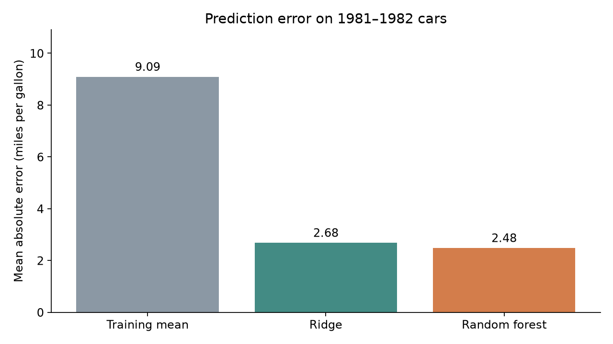
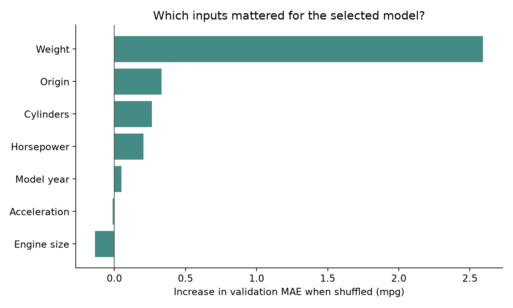

How accurately can basic car specifications predict fuel economy for cars a model has not seen? I compare two approaches, ridge regression and a random forest, with a simple benchmark that predicts the training-period average for every car. This comparison shows whether the extra information helps predict fuel economy.

The data describe cars from 1970 to 1982, so this exercise is not a guide to buying a new car. The outcome is city fuel economy in miles per gallon (mpg).

## Data and a fair comparison

The [UCI Auto MPG dataset](https://archive.ics.uci.edu/dataset/9/auto+mpg) contains 398 cars. I use cylinders, engine displacement, horsepower, weight, acceleration, model year, and origin as predictors. Six cars have missing horsepower values. Within each training split, I replace missing horsepower with that split's median; I do not use later cars to fill in earlier ones. I leave car names out of the models.

Randomly mixing cars from every year could give a model information about the future. Instead, I keep later model years separate. I use the 280 cars from 1970–1978 to tune each model with three expanding, year-based training and validation splits. I then compare the tuned models on 58 cars from 1979–1980. Only after selecting a model do I refit each approach using all cars through 1980 and evaluate them on the final 60 cars from 1981–1982. The last group plays no role in tuning or model selection.

Ridge regression fits a linear relationship but shrinks its coefficients to limit overfitting. The random forest averages many decision trees and can capture nonlinear patterns. I tune the ridge penalty and the forest's depth and minimum leaf size using the earlier splits. I choose between the two using validation root mean squared error (RMSE), which gives larger mistakes more weight. Ridge has a validation RMSE of 6.30 mpg, compared with 6.68 for the forest, so I select ridge before examining the final test results.

## How well do the predictions work?

The benchmark misses by 9.09 mpg per car on average, measured by mean absolute error (MAE). Ridge reduces that error to 2.68 mpg, while the random forest reaches 2.48 mpg. Both improve on the constant prediction in this test. Although the forest has a lower test MAE, I keep ridge as my choice because it performed better on the validation period. Choosing again after seeing the test results would require a fresh test to evaluate that decision fairly.

On the final test, ridge has an RMSE of 3.43 mpg and the forest has 3.66 mpg. The forest has a lower average absolute error, while ridge has a lower squared-error measure.

The benchmark faces a time shift: average fuel economy is 22.18 mpg among cars through 1980 but 31.04 mpg in the test group. The models can use each car's characteristics, although this comparison does not show what caused the change.

## What did the selected model use?

To understand ridge, I shuffle one input at a time in the validation data and measure how much its MAE changes. Shuffling weight increases error by about 2.59 mpg, more than any other input in this exercise. That suggests the fitted model relies heavily on weight. It does not show that changing a car's weight alone would produce a particular fuel-economy change. Several specifications move together, and the importance of one can depend on the others.

I calculate this figure with the model trained through 1978, on the same 1979–1980 data used to select it. The ranking is therefore an exploratory description, not an independent test of feature importance. Some changes are close to or below zero: shuffling those inputs did not reliably worsen validation error here.

## Takeaway

Basic specifications predicted these later-year cars much better than the earlier-period average. Weight mattered most to the selected model on the validation data. This small historical dataset cannot establish how either model would perform on modern vehicles; a current dataset and a fresh holdout would be necessary for that decision.

Data: [UCI Auto MPG](https://doi.org/10.24432/C5859H), CC BY 4.0. [Code and replication instructions](https://github.com/qianzhaoli949-afk/qianzhao-website/tree/main/blog/posts/post10).
