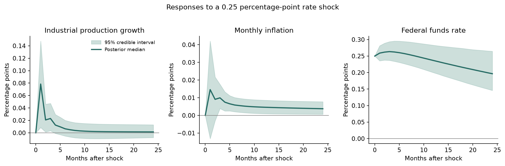
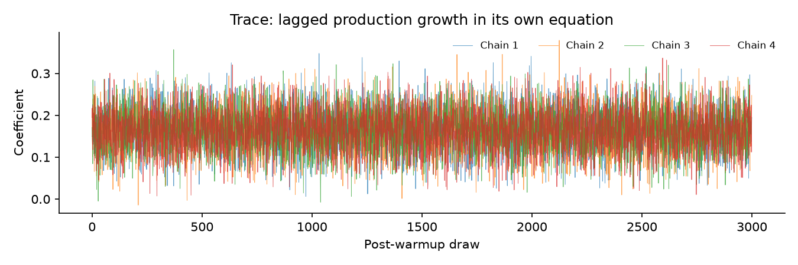

How do monthly industrial production growth and inflation respond to an unexpected rise in interest rates? A simple chart cannot answer this question: the Federal Reserve also changes rates in response to economic conditions. I use a Bayesian structural vector autoregression (SVAR) to study the response to an unexpected increase in the federal funds rate under a particular set of assumptions.

The model estimates a positive response in production growth in the first month, but a small and uncertain response after one year. Estimated monthly inflation also rises slightly after one year.

## Data and the question

I use monthly U.S. [industrial production](https://fred.stlouisfed.org/series/INDPRO), [consumer prices](https://fred.stlouisfed.org/series/CPIAUCSL), and [federal funds rate](https://fred.stlouisfed.org/series/FEDFUNDS) data from FRED, covering January 1990 through December 2019. These revised data differ from the information policymakers had at the time.

The VAR uses 100 times the monthly log changes in production and prices to approximate monthly growth and inflation. The interest rate stays in percentage points. Each variable depends on two months of its own and the other variables' past values. After transformations and lags, the model uses 357 observations.

## Separating a policy shock

A reduced-form VAR describes how surprises in the three variables occur together. It cannot tell whether an interest-rate surprise reflects a policy decision or the Fed's response to unexpected economic news: different shocks can produce the same residual correlations.

To separate them, I order the variables as production growth, inflation, and the funds rate. A recursive, or Cholesky, identification assumes production growth and inflation do not respond to the policy shock within the same month. It allows the funds rate to respond within the month to surprises in both. I then scale the identified rate shock to an initial increase of 0.25 percentage points. This is an assumption about timing, not something the data prove. Another ordering could give different results, and this shock may still include influences that are not pure monetary policy.

## What the Bayesian model adds

The model combines a prior with a likelihood to obtain a posterior distribution. I use a normal–inverse-Wishart prior centered on zero for the coefficients, with a relatively diffuse intercept. The likelihood describes the observations given the coefficients and residual covariance. The README records the prior settings.

I use a Gibbs sampler, an MCMC method, to alternate draws of the covariance matrix and coefficients. For each draw, I identify the rate shock and calculate responses over 24 months. The line is the posterior median; shading shows pointwise 95% credible intervals. These intervals depend on the model and do not include uncertainty about the identifying assumptions.

In the first month after the shock, the median response of industrial production growth is 0.078 percentage points, with a 95% credible interval from 0.009 to 0.148. By month 12, the median falls to approximately 0.002, and the interval runs from −0.009 to 0.014. Because that interval includes zero, the model does not show a clear direction for production growth at the one-year horizon.

Inflation's first-month median response is about 0.015 percentage points, but its interval includes zero. After 12 months, the median response is about 0.005 percentage points per month, with an interval of roughly 0.001 to 0.009. That small positive response does not establish that raising rates causes inflation to rise: timing assumptions, omitted variables, or the sample may matter.

The rate remains about 0.24 percentage points above baseline after 12 months at the posterior median. These are responses relative to a no-shock path, not forecasts. The production and inflation panels show changes in *monthly growth rates*, not cumulative changes in their levels.

## Did the chains settle?

I run four chains, discard 1,000 warmup draws from each, and retain 3,000 per chain. The largest classical split-R-hat across the 21 coefficients and six distinct covariance entries is 1.001 when rounded to three decimals; none exceeds 1.01. The trace plot below shows one coefficient across all four chains. These checks are reassuring but do not prove convergence or validate the economic assumptions.

## Takeaway

In this sample, the model estimates a positive production-growth response in the first month, but no clear direction after one year. At that horizon, estimated monthly inflation is slightly higher. I would not use these results alone to claim that monetary tightening raises inflation: the conclusions depend on the timing assumptions used to identify the shock.

The [replication guide and code](https://github.com/qianzhaoli949-afk/qianzhao-website/tree/main/blog/posts/post11) include the data snapshot, prior, sampler, and results. For the Bayesian VAR framework, see the [Bank of England's applied Bayesian econometrics guide](https://www.bankofengland.co.uk/-/media/boe/files/ccbs/resources/applied-bayesian-econometrics-for-central-bankers-updated-2017.pdf).
