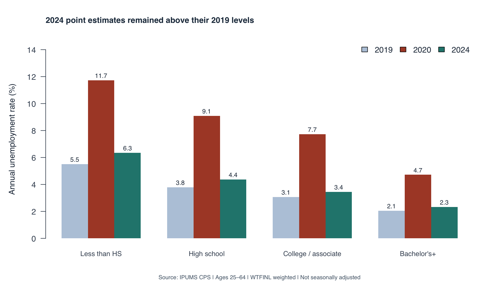
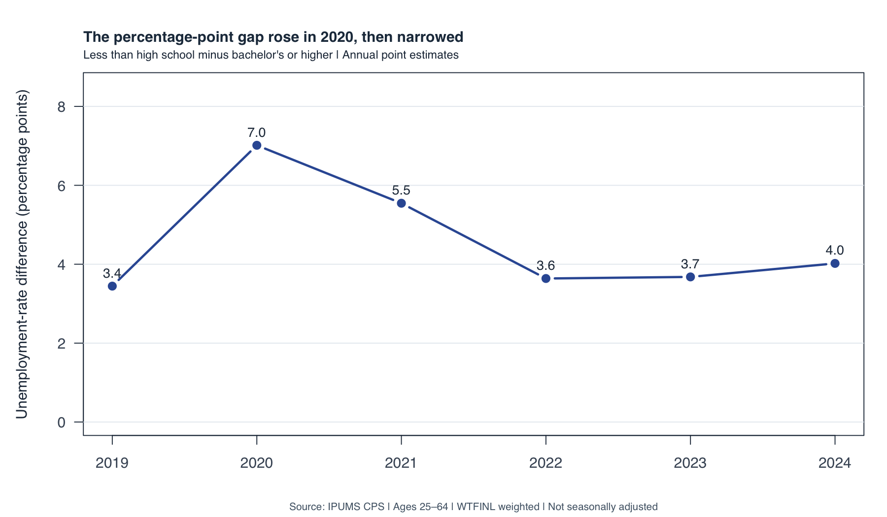

```{r}
#| include: false
s <- readRDS("summary.rds")
source("plots.R")
draw_figures(s)
gaps <- education_gaps(s)
gap <- function(year) gaps$gap_percentage_points[gaps$YEAR == year]
ratio <- function(year) gaps$rate_ratio[gaps$YEAR == year]
rate <- function(year, group) s$annual$unemployment_rate[s$annual$YEAR == year & s$annual$education == group]
fmt <- function(x) sprintf("%.1f", x)
```

How did unemployment differ across education groups from 2019 to 2024?
I use IPUMS Current Population Survey (CPS) data to look at two separate
questions: which groups had higher unemployment, and how far apart were their
rates? A group can stay at the top of the ranking even when the distance between
groups changes. I first compare the rates, then calculate that distance directly.

## Measuring unemployment consistently

The extract contains all 72 Basic Monthly samples from January 2019 to December
2024, restricted to ages 25–64. This focuses on working-age adults beyond the
usual college years. I group education into less than high school, high school,
some college or an associate degree, and a bachelor's degree or higher. These
groups describe completed education, not current enrollment.

Every estimate uses [WTFINL](https://cps.ipums.org/cps-action/variables/WTFINL),
the monthly person weight. The unemployment rate is weighted unemployed people
divided by the weighted civilian labor force, not all adults:

$$
u_g = 100\frac{\sum_{i\in g} w_i\,1(\text{unemployed}_i)}
{\sum_{i\in g} w_i\,1(\text{employed or unemployed}_i)}.
$$

People outside the labor force do not enter this denominator. Annual rates divide
the sum of monthly weighted unemployment totals by the sum of monthly weighted
labor-force totals. They are ratios of annual-average levels, not simple averages
of monthly percentages. All figures are **not seasonally adjusted**.

## 1. All four groups experienced a rise in unemployment

{fig-alt="Four monthly lines from 2019 to 2024 show a sharp 2020 increase in unemployment, largest for adults without a high school diploma and smallest for college graduates."}

The monthly lines show a sharp rise in spring 2020, followed by a decline.
Adults without a high school diploma generally have the highest rate, while
college graduates generally have the lowest. This shows a persistent difference
in unemployment levels. The ranking alone does not tell us whether the gap grew:
we need to compare the size of the differences, not just the order of the lines.

## 2. Annual rates make the comparison easier

{fig-alt="Grouped bars compare four education groups in 2019, 2020, and 2024. All groups rise in 2020 and fall by 2024, while remaining above their 2019 rates."}

Among adults without a high school diploma, unemployment rose from
`r fmt(rate(2019,1))`% in 2019 to `r fmt(rate(2020,1))`% in 2020.
For adults with a bachelor's degree or higher, it rose from
`r fmt(rate(2019,4))`% to `r fmt(rate(2020,4))`%. All four groups had higher
annual rates in 2020 than in 2019, even though their ranking stayed the same.

By 2024, their rates had fallen to `r fmt(rate(2024,1))`% and
`r fmt(rate(2024,4))`%, respectively. Each group's 2024 estimate remained above
its 2019 value. This is a descriptive comparison, not a claim that these small
remaining differences are statistically significant.

## 3. Measure the gap directly

For a clear comparison, I define the gap as the unemployment rate for adults
without a high school diploma minus the rate for adults with a bachelor's
degree or higher. I measure this difference in percentage points, not percent.
This comparison covers two groups; it does not summarize every education gap.

{fig-alt="A line with annual labels directly shows the percentage-point difference between the lowest and highest education groups from 2019 through 2024."}

The estimated gap rose from `r fmt(gap(2019))` percentage points in 2019 to
`r fmt(gap(2020))` in 2020, then fell to `r fmt(gap(2024))` by 2024.
It did not fall every year: the estimate reached `r fmt(gap(2022))` points
in 2022 before rising slightly in 2023 and 2024.
This calculation, rather than the unchanged rankings, supports the description
of a larger absolute gap in 2020.

The choice of measure matters. Dividing the two rates instead gives a ratio
of `r sprintf("%.2f",ratio(2019))` in 2019 and
`r sprintf("%.2f",ratio(2020))` in 2020: the relative gap became smaller.
I therefore describe an increase in the percentage-point gap, not an increase
under every measure. These are descriptive estimates without confidence
intervals. They do not establish statistical significance or show that the
pandemic itself caused the change.

## 4. Compare adults within age groups

{fig-alt="Three panels for ages 25–34, 35–49, and 50–64 show the education gradient within each age group across 2019, 2020, and 2024."}

Education groups may contain different mixes of younger and older workers.
I also compare rates within ages 25–34, 35–49, and 50–64. The figure shows a
similar education pattern within these broad age groups: adults with less
education tend to have higher unemployment. This adds detail to the overall
comparison, but it does not hold age or other characteristics fully constant.
People in the same age band can still differ in experience, occupation, and
industry. The figure does not measure the causal effect of a degree.

## Takeaway and limitations

The figures tell a specific story. All four groups had higher unemployment
in 2020 than in 2019. The percentage-point gap between the lowest and highest
education groups grew in 2020 and narrowed by 2024, while the rate ratio tells
a different story about 2019–2020. The age panels also show differences within
broad age groups. These findings describe who had higher unemployment and how
the rates changed; they do not explain why or tell us which policy would help.

CPS respondents can appear in multiple months, so the
`r format(s$audit['retained'], big.mark=',', scientific=FALSE, trim=TRUE)` retained
records are person-month observations, not unique people. The charts present
weighted point estimates without confidence intervals. Pandemic-era
[collection disruptions and lower response rates](https://cps.ipums.org/cps/covid19.shtml)
also warrant caution. Finally, unemployment alone cannot reveal whether people
left the labor force, accepted fewer hours, or experienced wage losses.

## Data and reproducibility

Source: [IPUMS CPS, University of Minnesota](https://cps.ipums.org/cps/citation.shtml),
using underlying U.S. Census Bureau and Bureau of Labor Statistics data.
Extract created September 27, 2026. Education definitions follow
[IPUMS EDUC documentation](https://cps.ipums.org/cps-action/variables/EDUC).

Download the [code and grouped summaries](code-and-summaries.zip),
[analysis script](analyze.R), [plotting script](plots.R),
[annual gap calculations](education-gaps.csv), and
[reproduction instructions](REPRODUCE.txt).
The [GitHub repository](https://github.com/qianzhaoli949-afk/qianzhao-website)
contains this post under `blog/posts/post3/`. Licensed microdata are not redistributed;
registered users can recreate the extract using the documented selections.

```{r}
#| eval: false
# From the post3 folder, after running analyze.R with your local extract paths:
s <- readRDS("summary.rds")
source("plots.R")
draw_figures(s)
```
