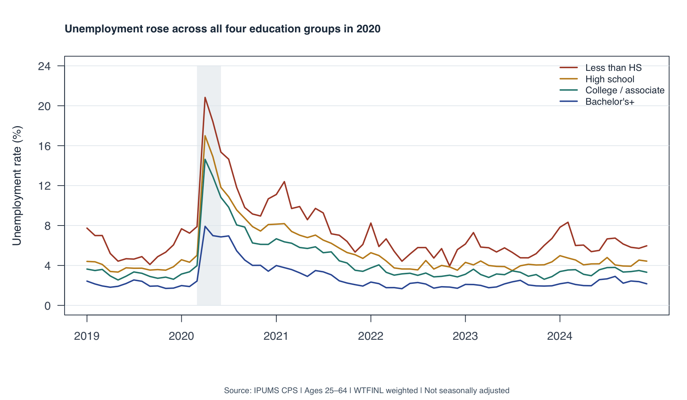
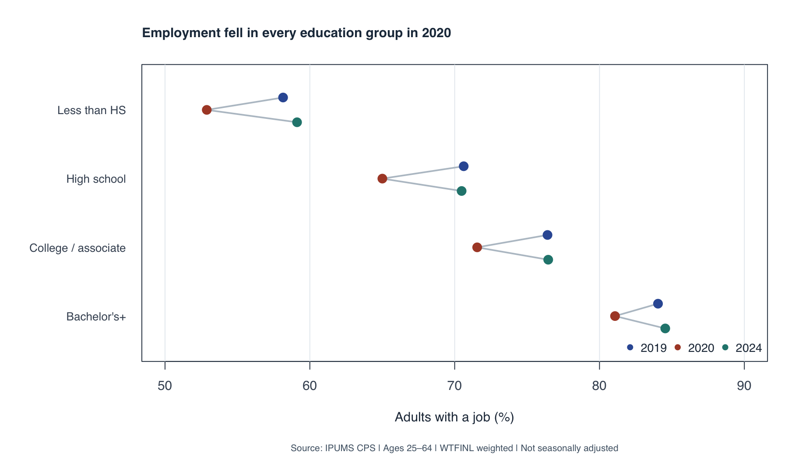
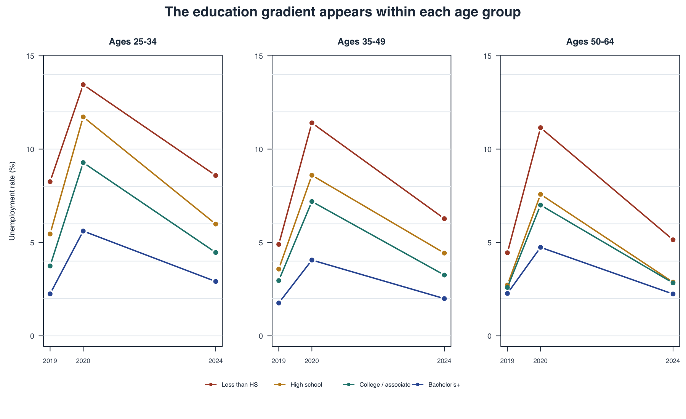

```{r}
#| include: false
s <- readRDS("summary.rds")
source("plots.R")
draw_figures(s)
gaps <- education_gaps(s)
gap <- function(year) gaps$gap_percentage_points[gaps$YEAR == year]
ratio <- function(year) gaps$rate_ratio[gaps$YEAR == year]
rate <- function(year, group) s$annual$unemployment_rate[s$annual$YEAR == year & s$annual$education == group]
job_share <- function(year, group) s$annual$employment_population[s$annual$YEAR == year & s$annual$education == group]
age_rate <- function(year, group, ages) s$age$unemployment_rate[s$age$YEAR == year & s$age$education == group & s$age$age_group == ages]
fmt <- function(x) sprintf("%.1f", x)
```

When unemployment falls, does that mean more people have jobs? Not necessarily:
the unemployment rate excludes adults who are not looking for work. This matters
when we compare education groups after a major labor-market shock. I use the
Current Population Survey (CPS) to ask how unemployment changed from 2019 to
2024, whether employment among *all* adults followed the same path, and whether
the education pattern also appears within age groups.

## 1. Unemployment jumped, but rankings do not show the size of a gap

{fig-alt="Four monthly lines from 2019 to 2024 show a sharp 2020 increase in unemployment, largest for adults without a high school diploma and smallest for college graduates."}

The spring 2020 spike affected all four education groups. The annual rate for
adults without a high school diploma rose from `r fmt(rate(2019,1))`% in 2019
to `r fmt(rate(2020,1))`% in 2020. For bachelor's degree holders, it rose from
`r fmt(rate(2019,4))`% to `r fmt(rate(2020,4))`%. Their ranking stayed the
same, but the difference between those two rates widened from
`r fmt(gap(2019))` to `r fmt(gap(2020))` **percentage points**. Dividing the
rates tells a different story: the ratio fell from
`r sprintf("%.2f",ratio(2019))` to `r sprintf("%.2f",ratio(2020))`.
The gap grew in absolute terms, not relative terms. By 2024, the difference
had narrowed to `r fmt(gap(2024))` points.

## 2. Count adults with jobs, not only job seekers

{fig-alt="A dot chart shows the employed share of adults by education. All four groups fell in 2020, then mostly returned to their 2019 levels by 2024."}

Unemployment counts only people in the labor force. The next chart instead
divides the number with a job by *all* adults in each education group, including
people who are not seeking work. Among adults without a high school diploma,
the employed share fell from `r fmt(job_share(2019,1))`% in 2019 to
`r fmt(job_share(2020,1))`% in 2020. Among bachelor's degree holders, it fell
from `r fmt(job_share(2019,4))`% to `r fmt(job_share(2020,4))`%.
By 2024, those shares were `r fmt(job_share(2024,1))`% and
`r fmt(job_share(2024,4))`%. This wider view confirms that a smaller share of
both groups had jobs in 2020; the unemployment lines alone cannot tell us
that. It also shows a persistent difference in employment levels between
education groups.

## 3. Check the pattern within age groups

{fig-alt="Three panels for ages 25–34, 35–49, and 50–64 show the education gradient within each age group across 2019, 2020, and 2024."}

The education groups also contain different mixes of younger and older adults.
The final figure compares unemployment within three age bands. In 2024, among
25–34-year-olds, the rate was `r fmt(age_rate(2024,1,"25-34"))`% without a
high school diploma versus `r fmt(age_rate(2024,4,"25-34"))`% with a bachelor's
degree or higher. The pattern appears within the older bands too. Differences
in age mix therefore do not fully account for the overall education pattern.

## Takeaway

The 2020 unemployment increase widened the lowest-to-highest education gap
in percentage points, even as the ratio between their rates fell. Employment
among all adults also dropped in 2020 and had largely recovered by 2024;
the education difference remained. The age panels show that this pattern is
not just a comparison of young people with older people. Looking at all three
views gives a clearer picture of labor-market recovery than a single
unemployment ranking.

These are descriptive, [WTFINL-weighted](https://cps.ipums.org/cps-action/variables/WTFINL)
estimates for ages 25–64, not evidence that a degree caused the differences.
The monthly data are not seasonally adjusted, and the charts do not include
confidence intervals. [CPS collection changed during the pandemic](https://cps.ipums.org/cps/covid19.shtml),
which also limits close comparisons.

## Data and reproducibility

Source: [IPUMS CPS, University of Minnesota](https://cps.ipums.org/cps/citation.shtml),
using underlying U.S. Census Bureau and Bureau of Labor Statistics data.
I use all 72 Basic Monthly samples from January 2019 through December 2024
and group completed education into four levels. The unemployment denominator
includes employed and unemployed adults who are looking for work; the
employment-share denominator includes all civilians in each group. Annual
rates use sums of weighted monthly counts, not simple averages of monthly
percentages. The extract was created September 27, 2026. Education definitions follow
[IPUMS EDUC documentation](https://cps.ipums.org/cps-action/variables/EDUC).

Download the [code and grouped summaries](code-and-summaries.zip),
[analysis script](analyze.R), [plotting script](plots.R),
[annual gap calculations](education-gaps.csv), and
[reproduction instructions](REPRODUCE.txt).
The [GitHub repository](https://github.com/qianzhaoli949-afk/qianzhao-website)
contains this post under `blog/posts/post3/`. Licensed microdata are not redistributed;
registered users can recreate the extract using the documented selections.

```{r}
#| eval: false
# From the post3 folder, after running analyze.R with your local extract paths:
s <- readRDS("summary.rds")
source("plots.R")
draw_figures(s)
```
