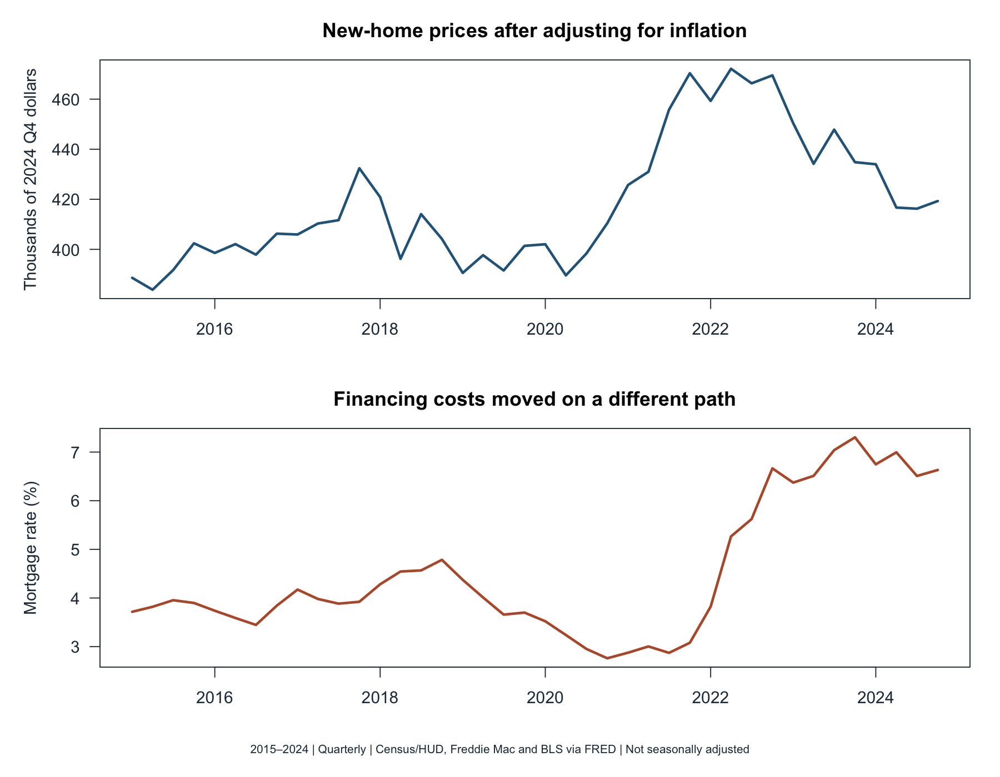
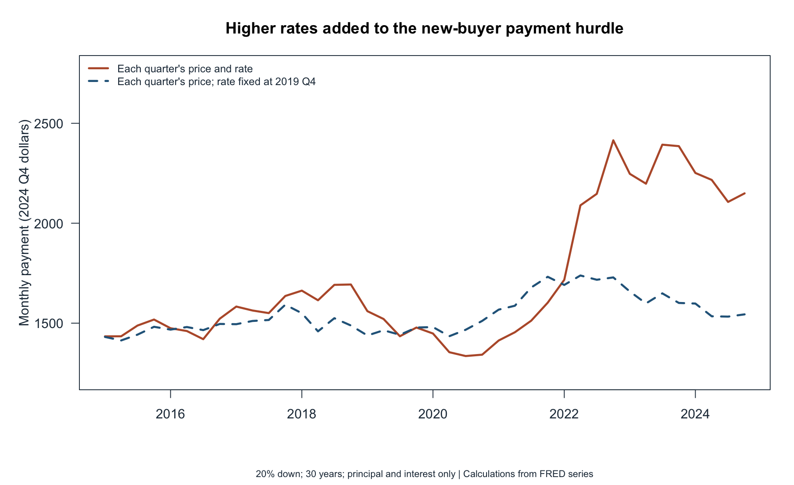
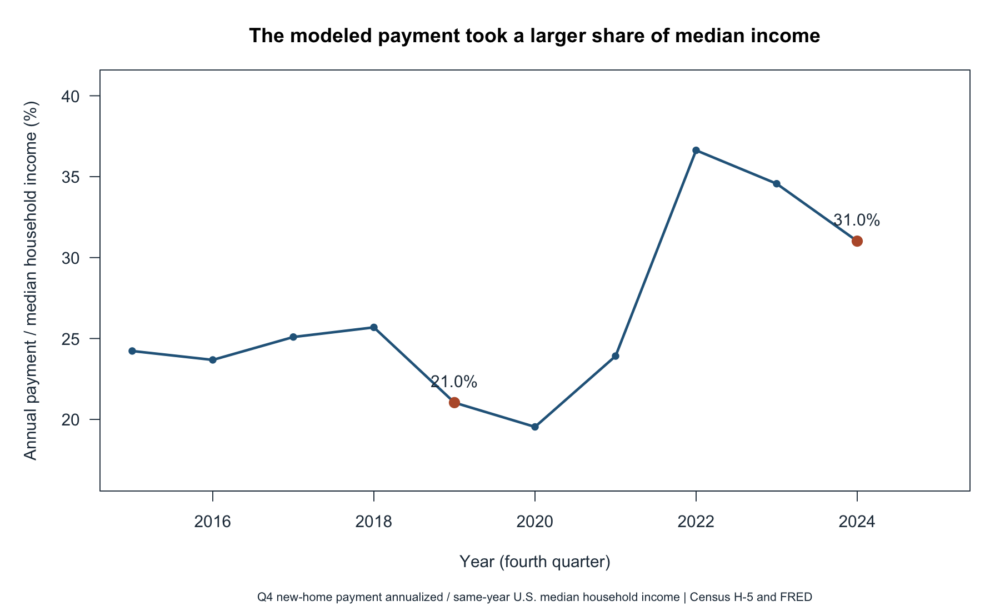

```{r}
#| include: false
source("code/analyze.R")
old <- d[d$quarter == "2019Q4", ]
end <- d[d$quarter == "2024Q4", ]
income_old <- affordability[affordability$year == 2019, ]
income_end <- affordability[affordability$year == 2024, ]
usd <- function(x) paste0("$", format(round(x), big.mark=",", trim=TRUE))
pct <- function(x) sprintf("%.1f", x)
```

What changed a new-home buyer's monthly payment more between late 2019 and
late 2024: the home's price or the mortgage rate? In my model, the payment
rose about **`r usd(scenarios$payment[4]-scenarios$payment[1])` per month** in
2024 dollars. Changing only the rate adds about
`r usd(scenarios$payment[3]-scenarios$payment[1])`; changing only the
inflation-adjusted price adds about
`r usd(scenarios$payment[2]-scenarios$payment[1])`. The two changes also
interact, adding the remaining
`r usd(scenarios$payment[4]-scenarios$payment[3]-scenarios$payment[2]+scenarios$payment[1])`.
The rate increase did most of the work.

## 1. Prices and rates moved differently

{fig-alt="Two aligned panels show inflation-adjusted new-home prices and mortgage rates from 2015 to 2024."}

The median price of a new home rose just
`r pct(100*(end$real_price/old$real_price-1))`% after adjusting for overall
inflation between 2019 Q4 and 2024 Q4. The average 30-year mortgage rate,
however, climbed from `r pct(old$rate)`% to `r pct(end$rate)`%. A home can
therefore cost much more each month even when its inflation-adjusted price
changes only a little.

## 2. Turn those changes into a monthly payment

{fig-alt="Two lines compare real mortgage payments using each quarter's rate with payments at a fixed 2019 Q4 rate."}

I assume a 20% down payment and a 30-year fixed-rate loan. Under those
assumptions, the monthly principal-and-interest payment rose from
`r usd(old$payment_real)` to `r usd(end$payment_real)` in 2024 Q4 dollars.
The dashed line asks what the payment would have been if the rate had stayed
at its 2019 Q4 level while prices followed their actual path. At the 2024
price, that payment would have been `r usd(end$payment_fixed_rate_real)`,
`r usd(end$payment_real-end$payment_fixed_rate_real)` below the modeled
payment with the 2024 rate. This gap includes the small interaction between
the higher rate and the changed price; it is not the rate-only figure quoted
above.

## 3. Compare the payment with income

{fig-alt="A line chart shows the modeled payment rising from about 21 percent of median household income in 2019 to about 31 percent in 2024."}

This third figure asks a different question: how large is the modeled payment
beside a typical household's income? I multiply each fourth-quarter monthly
payment by 12 and divide it by the [Census Bureau's annual U.S. median
household income](https://www.census.gov/data/tables/time-series/demo/income-poverty/historical-income-households.html).
I use current dollars for both the payment and income in each year. The share
rose from `r pct(100*income_old$payment_share)`% in 2019 to
`r pct(100*income_end$payment_share)`% in 2024. Median income grew, but it
did not keep up with the payment in this comparison.

## Takeaway

Of the roughly `r usd(scenarios$payment[4]-scenarios$payment[1])` increase in
the inflation-adjusted monthly payment, about
`r usd(scenarios$payment[3]-scenarios$payment[1])` comes from the higher rate
alone and only about `r usd(scenarios$payment[2]-scenarios$payment[1])` from
the higher real price alone. Their interaction accounts for the rest. The
payment also rose from about `r pct(100*income_old$payment_share)`% to
`r pct(100*income_end$payment_share)`% of median income. For a prospective
buyer, the interest rate deserves as much attention as the listing price.

These figures provide a national benchmark, not a measure of what a particular
buyer can afford. The new-home median changes with the mix of homes sold; the
median-income household need not buy a new home. I also leave out property
taxes, insurance, maintenance, fees, and the down payment itself. The price,
rate, and CPI data are not seasonally adjusted, so I compare the same quarter
in each year. Freddie Mac changed its mortgage survey methodology in 2022.

## Data and method

I use [new-home prices](https://fred.stlouisfed.org/series/MSPUS),
[mortgage rates](https://fred.stlouisfed.org/series/MORTGAGE30US), and
[consumer prices](https://fred.stlouisfed.org/series/CPIAUCNS) from FRED,
plus [Census Table H-5](https://www2.census.gov/programs-surveys/cps/tables/time-series/historical-income-households/h05.xlsx)
for income. I average the weekly rates and monthly CPI values within each
quarter, then convert prices and payments to 2024 Q4 dollars. I calculate
the payment for each quarter's price and rate and repeat the calculation with
one 2019 Q4 input held fixed at a time. Those comparisons describe loan
arithmetic, not a causal effect of interest-rate policy on house prices.

## Reproduce the analysis

The [README](README.md) documents folders, assumptions, and commands.
[Analysis code](code/analyze.R), [plotting code](code/plots.R),
[quarterly data](data/quarterly.csv), [income comparison](results/affordability.csv),
and [download provenance](data/manifest.csv)
are available alongside the [GitHub repository](https://github.com/qianzhaoli949-afk/qianzhao-website/tree/main/blog/posts/post4).
Ordinary rendering checks and reuses saved downloads; an explicit refresh
retrieves new data, which may include revisions.
