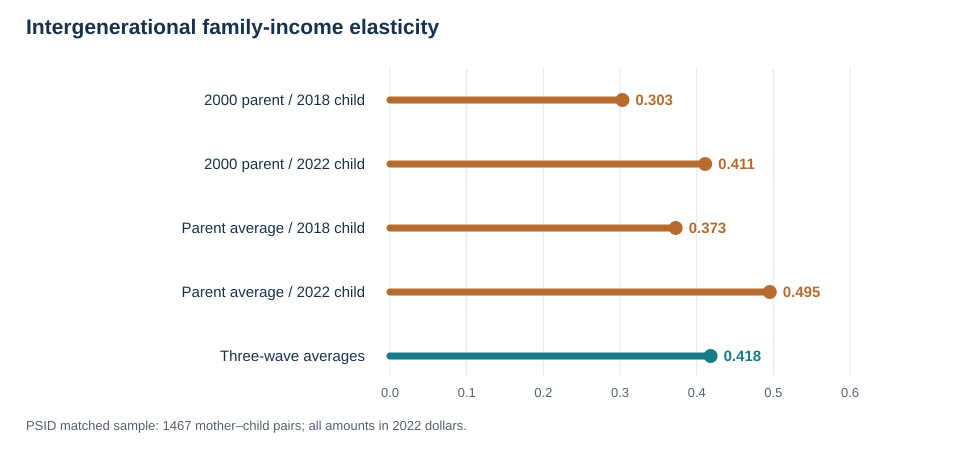

How can we follow a child after they leave their parents' household? And
does an estimate of intergenerational income persistence change when we
replace one year's income with an average across several years? I use
[PSID](https://psidonline.isr.umich.edu/) data to answer these questions
with SQL inside Python. The goal is to show a reproducible match and a
careful comparison, not to claim that one estimate captures a causal
effect.

## Start with individual IDs

I downloaded two PSID Data Center extracts: the Parent Identification
File and a cross-year individual file. The first has 103,725 records; the
second has 40,637. In the parent file, `PID2` and `PID3` identify the
child, while `PID4` and `PID5` identify the birth mother. The individual
file uses `ER30001` and `ER30002` as stable personal IDs. These IDs,
not a shared address or household number, establish the parent–child
link. The core of the [complete SQL query](code/psid_match.sql) is:

```sql
FROM pid AS p
JOIN person AS child
  ON child.id_1968 = p.child_1968
 AND child.person_no = p.child_person
JOIN person AS mother
  ON mother.id_1968 = p.mother_1968
 AND mother.person_no = p.mother_person
```

`SELECT` chooses the IDs and income measures we need. `JOIN` connects
the verified mother–child pair to each person's records. `GROUP BY`
then gathers each person's income observations, and `AVG` creates a
three-wave measure. For example:

```sql
SELECT id_1968, person_no, AVG(real_income) AS parent_avg
FROM income
WHERE income_year IN (2000, 2002, 2004)
GROUP BY id_1968, person_no;
```

The [Python script](code/analyze_psid.py) reads the two fixed-width
extracts directly from their ZIP files, loads selected fields into an
in-memory SQLite database, runs the SQL, and calculates the slopes. It
does not save a person-level matched file.

## Compare the same pairs

I use *family income*, not individual wages. Parent income refers to
2000, 2002, and 2004; adult-child income refers to 2018, 2020, and 2022.
I convert each amount to 2022 dollars using annual averages of
[FRED's CPI series](https://fred.stlouisfed.org/series/CPIAUCNS).
The [CPI table](data/cpi_annual.csv) records the six values used.

The analysis keeps children aged 30–40 in 2023 and birth mothers aged
35–70 in 2005, with a plausible 15–45 year age gap. Each person must
have positive, usable income in all three relevant waves and be the
family reference person, spouse, or partner in those waves. These rules
leave 1,467 mother–child pairs. I use this **same selected sample** for
every comparison.

For each income measure, I estimate the slope in
$\log(\text{child family income})=\alpha+\beta\log(\text{mother family income})+\varepsilon$.
Here $\beta$ is an intergenerational elasticity: a 10% difference in
a mother's family income corresponds approximately to a $10\beta$%
difference in the adult child's family income in this sample. It is a
descriptive association.

| Mother's family-income measure | Adult child's family-income measure | Elasticity |
|:--|:--|--:|
| 2000 only | 2018 only | 0.303 |
| 2000 only | 2022 only | 0.411 |
| Average, 2000–2004 | 2018 only | 0.373 |
| Average, 2000–2004 | 2022 only | 0.495 |
| Average, 2000–2004 | Average, 2018–2022 | 0.418 |

{fig-alt="Horizontal chart of five PSID elasticities: 0.303, 0.411, 0.373, 0.495, and 0.418."}

With the child's year fixed at 2018, averaging the mother's family income
changes the estimate from 0.303 to 0.373. With the mother's measure fixed
at 2000, using the child's 2022 rather than 2018 family income changes it from
0.303 to 0.411. The three-wave average for both generations yields
0.418, which is *below* the 0.495 estimate that uses only the child's
2022 income. Averaging does not mechanically raise an elasticity.

## What the comparison can—and cannot—show

One year's income may reflect a temporary shock or a particular career
stage. Averaging several years can smooth short-lived changes, so it may
better represent long-run economic status. A separate
[simulation in this repository](results/elasticities.csv) makes the
life-cycle problem explicit: its designed long-run sample slope is
0.444, while a single early-career year produces 0.149. Those numbers
come from **invented data**, not the PSID.

The real PSID results show sensitivity to timing and averaging, but they
do not isolate life-cycle bias. The child's age changes between 2018 and
2022, and the economy changes too. We also cannot observe each family's
true permanent income. This sample excludes many families without
complete positive income records, and I do not apply survey weights.
It therefore does not represent a national mobility estimate.

The practical lesson is to verify family links with individual IDs,
compare income measures on the same sample, and state exactly what each
comparison identifies. The [replication guide](README.md) lists the
extract variables, commands, outputs, and privacy rules. It links the
[aggregate estimates](results/psid_estimates.csv); the raw PSID records
remain outside the public repository. [Haider and Solon](https://www.nber.org/papers/w11943)
discuss why income measured at different ages can relate differently to
long-run income.
