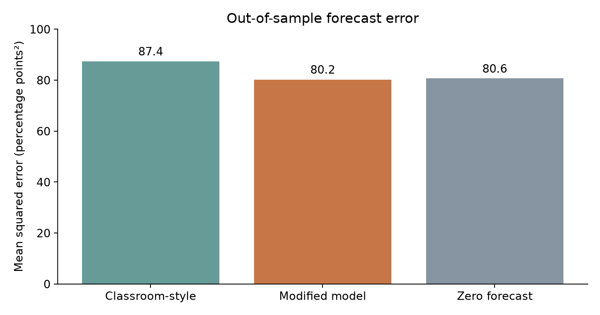
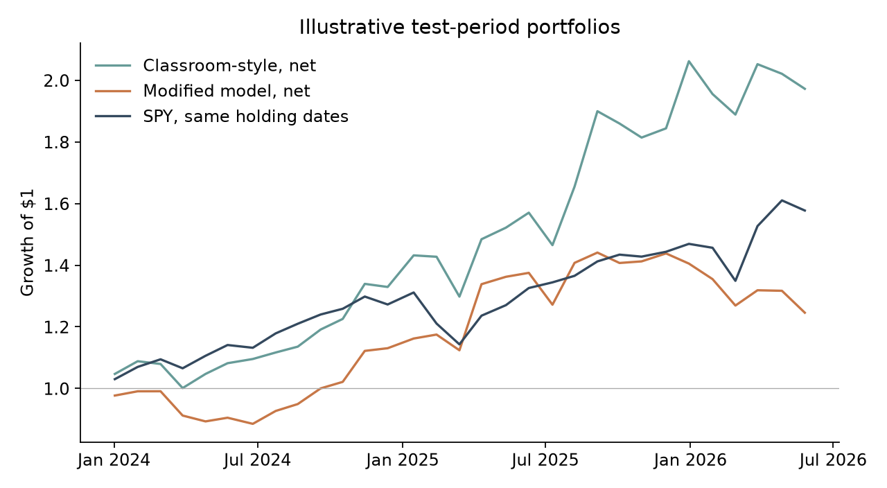

In class, we used gradient boosting to ask whether recent stock-price patterns
could predict future returns. Would a simpler model predict better on new data?
Would better predictions also lead to better investment results?

## The classroom experiment

The classroom R script downloads daily prices for 95 large U.S. stocks and
SPY, an ETF that tracks the S&P 500. It builds variables for recent price
changes, volatility, and returns relative to SPY. An XGBoost model predicts
the return between the next trading day's close and the close 20 trading
days after the signal. The script then selects ten stocks with the highest
predicted returns and compares a portfolio with SPY.

Stock returns are hard to forecast because prices respond to unexpected news.
Past data contain noise as well as patterns, and a flexible model can fit
that noise. I therefore evaluate predictions on later data.

## What I changed

I reproduce the classroom model's 300 trees, depth of five, learning rate of
0.05, and original price-based inputs in Python. This is a **classroom-style
reconstruction**, not an exact rerun of the R script: the software interface,
downloaded data vintage, and evaluation procedure differ. The classroom
momentum formulas divide an earlier price by a later price; I preserve that
definition for the comparison model.

For my attempted improvement, I use return-based inputs, reverse the momentum
ratios to measure later prices relative to earlier prices, and test three
smaller tree settings. I select the settings using 2023 data and then refit on
the available pre-2024 training data. I remove training observations whose
20-day outcome reaches the next period. The test starts in January 2024 and
ends with signals from June 2026. A forecast of zero return provides a simple
prediction benchmark. I use the same test observations for all three.

## Did prediction improve?

{fig-alt="Bar chart showing the classroom-style model has higher mean squared error than the modified model and the zero forecast, whose errors are close."}

The classroom-style model's test root mean squared error was 9.35 percentage
points. The modified model's was 8.96 points, slightly below the zero
forecast's 8.98 points. The chart uses squared-error units. The modified model
correctly predicted the sign of the return about
52% of the time; its mean absolute error was 6.45 points, slightly worse than
the zero forecast's 6.40. Its small gain on one measure does not make it a
reliably accurate predictor.

## Did that translate into a better portfolio?

{fig-alt="Line chart showing the classroom-style portfolio above SPY and the modified portfolio below SPY at the end of the test period."}

For each model, I rank stocks on the signal date, enter at the next close, and
hold the top ten until the close 20 trading days after the signal. I use the
classroom rule for weighting positive predictions, with equal weights if none
are positive. I repeat the exercise every 20 trading days and compare SPY over
the same entry and exit dates. Both strategies sit out the gap between exit
and the next entry; this SPY comparison is not continuous buy-and-hold.

After an illustrative cost of 0.1% on each purchase and sale, $1 grew to about
$1.97 in the classroom-style portfolio and $1.25 in the modified portfolio. SPY grew
to about $1.58 over those same holding windows, without an ETF trading-cost
deduction. The modified model had lower overall forecast error, yet its
portfolio lagged SPY. The classroom-style portfolio did better in this
particular test even though its average predictions were less accurate. A
model's ranking of the selected stocks can matter more for this strategy than
its average error across every stock.

## Takeaway

Simplifying the model reduced squared prediction error, but only barely
improved on predicting zero and did not improve the portfolio result. The
classroom-style portfolio's stronger result is interesting, not proof of a
repeatable advantage. This is one historical test using a fixed list of
large companies chosen with hindsight, so it can suffer from survivorship and
selection bias. The cost assumption is only an estimate; taxes, market impact,
capacity, and the day spent out of the market also matter. Adjusted prices can
be revised after corporate actions. I cannot conclude from this backtest that
either strategy will perform similarly in the future.

## Data and reproducibility

The stock-price snapshot comes from a [Yahoo Finance dataset](https://huggingface.co/datasets/AmirTrader/YahooFinance)
and SPY from a separate [Yahoo-derived daily-price archive](https://github.com/HerdingAI/stock-price-returns).
The fixed common data window ends in June 2026. The [README](README.md) lists
the sources, differences from the classroom script, assumptions, and commands.
The [analysis code](code/analyze.py), [price data](data/stock_prices.csv.gz),
[SPY data](data/spy.csv), [predictions](results/predictions.csv.gz), and
[portfolio results](results/backtest.csv) are included for reproduction.
